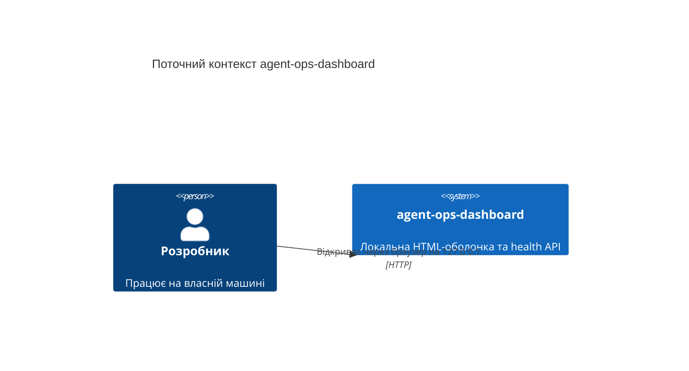
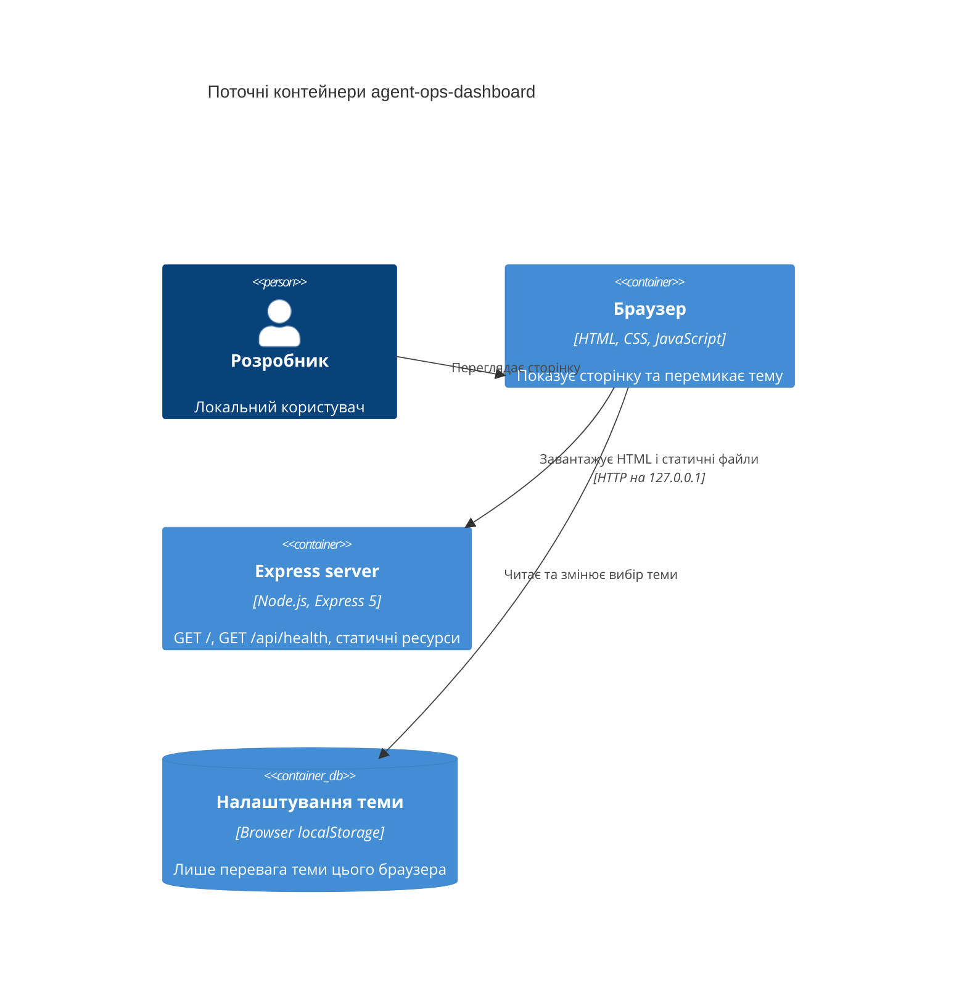

# Architecture map — agent-ops-dashboard

Карта поточного коду, створена повним brownfield-оглядом. Джерело стану — коміт
`772bc61`; майбутній обсяг із roadmap та ухвалені ADR самі по собі не означають
наявності реалізації. Карту читають наступні стадії SDD; після зміни коду її
потрібно оновити через survey.

## Stack

- JavaScript, ESM (`package.json:5`), Node.js `>=22` (`package.json:7`);
  рекомендована версія 24 (`.nvmrc:1`). Під час огляду: Node `v26.13.0`, npm `11.20.0`.
- Express — єдина пряма залежність: заявлено `^5.2.1` (`package.json:20`),
  lockfile фіксує `5.2.1` (`package-lock.json:245`). Dev-залежностей немає.
- Збірки, лінтера й інструмента міграцій немає; відповідні машинні ключі порожні.
  Тестові ворота — `npm run verify`: `node --test --test-reporter=spec "test/*.test.js"`
  (`package.json:10`). `preverify` спершу вирівнює mtime фікстур (`package.json:15`).
- `npm run demo` примусово використовує синтетичний `CLAUDE_HOME` і порт 4180
  (`scripts/demo.mjs:8`). `npm start` та `npm run dev` запускають сервер зі звичайним
  оточенням (`package.json:11`); для роботи агента застосовується demo.
- CI виконує `npm ci` та `npm run verify` на Linux, macOS і Windows для Node 22,
  24 та 26 (`.github/workflows/verify.yml:9`).

## C4 — system as it is

Контекст: один розробник відкриває застосунок на власній машині. Поточний runtime
обчислює шлях домашньої теки Claude Code й показує його; журнали не відкриває
(`lib/claude/index.js:6`, `server.js:13`).

Сервер — один процес, а `lib/` і `views/` — його внутрішні модулі, не окремі
сервіси. Реєстр джерел живе в пам'яті (`lib/sources.js:10`); browser localStorage
використовує лише `public/theme.js:5`. Теки сесій не показані як підключене сховище,
оскільки runtime ще не читає їх.

## Module inventory

| Module | Path | Layers | Wired at | Responsibility |
|---|---|---|---|---|
| HTTP-застосунок | `server.js` | Маршрути та складання відповіді разом | `server.js:9` | Express app, static middleware, два маршрути, окремий прямий запуск |
| Реєстр джерел | `lib/sources.js` | Реєстрація та доступ у пам'яті | `server.js:5` | `registerSource()`, `getSource()`, `listSources()` над Map |
| Адаптер Claude Code | `lib/claude/index.js` | Обчислення шляхів і самореєстрація | `server.js:4` | `claudeHome()`, `projectsDir()`, реєстрація `{id, label, home}` |
| HTML-шар | `views/layout.js` | Чисті функції представлення | `server.js:6` | `esc()`, `icon()`, `layout()`, `empty()` |
| Статичний frontend | `public/style.css`, `public/theme.js` | CSS і браузерна поведінка | `server.js:11`, `views/layout.js:69` | Токени, готові класи, системна та явна тема |
| Runtime-тести | `test/skeleton.test.js`, `test/helpers.js` | HTTP integration harness | `package.json:16` | Три тести оболонки на фікстурах із тимчасовим портом |
| Допоміжні перевірки | `test/oracle.js`, `test/*.check.js` | Підрахунки та контракти tooling | `test/oracle.js:9`, `test/verify-hook.check.js:1` | Oracle для синтетичних даних; `.check.js` запускаються окремо |
| Standalone tooling | `scripts/` | Скрипти поза runtime запитів | `package.json:10` | Demo, фіксація mtime, Stop-hook, перевірка навчальних артефактів |
| Синтетичне джерело | `fixtures/claude-home/` | Тестові дані на диску | `test/helpers.js:6`, `scripts/demo.mjs:6` | Шість основних сесій у трьох проєктах за `README.md`; жодних особистих логів |

Контролерів, сервісного шару, repository-шару та DI-контейнера немає: маршрут
безпосередньо викликає функції адаптера, реєстру й HTML-шару (`server.js:13`).
Теки `lessons/` та `examples/` не є runtime-модулями; під час цього survey їх не читали.

## Conventions (cited — the rules a new feature must match)

- **Module wiring / registration:** адаптер викликає `registerSource()` під час
  імпорту (`lib/claude/index.js:14`); імпорт у `server.js:4` обов'язковий.
  `registerSource()` перевіряє лише істинність значень `id`, `label`, `home`
  (`lib/sources.js:13`), без перевірки типів і того, чи `home` є функцією.
  Повторна реєстрація з тим самим ключем `id` замінює попередній адаптер
  через `Map.set()` (`lib/sources.js:16`).
  Реєстр повертає назовні список `{id, label}` (`lib/sources.js:26`).
- **Error handling:** звичайний `Error` без власних класів і кодів, наприклад
  невалідне джерело (`lib/sources.js:14`) або невідома іконка (`views/layout.js:41`).
  Централізованого власного error middleware немає (`server.js:9`).
- **IDs:** реалізований ідентифікатор джерела — рядок `claude`
  (`lib/claude/index.js:15`). ID сесії визначено словником як ім'я основного
  `<sessionId>.jsonl` (`CONTEXT.md:13`); runtime ще не витягає його з файлів.
- **Persistence / DB access:** адаптер лише обчислює шляхи (`lib/claude/index.js:6`).
  Синхронний доступ через `node:fs` і пропуск нечитабельних елементів показано
  в тестовому oracle (`test/oracle.js:3`, `test/oracle.js:13`); production-reader відсутній.
- **Migrations:** інструмента, SQL-схеми та команди міграцій немає
  (`package.json:10`, `lib/claude/index.js:1`). Не слід виводити їх із майбутніх ADR.
- **Tests:** `node:test` + `node:assert/strict`, HTTP-перевірки з cleanup
  (`test/skeleton.test.js:1`). Harness задає `CLAUDE_HOME` до імпорту сервера
  й слухає `127.0.0.1` на вільному порту (`test/helpers.js:8`).
  Перший тест перевіряє `ok === true`, рівність `claudeHome` шляху фікстур і
  наявність джерела з `id === 'claude'` (`test/skeleton.test.js:8`). Другий —
  `<title>agent-ops</title>` та згадку `Content-Security-Policy` у HTML
  (`test/skeleton.test.js:15`). Третій порівнює позиції рядків підключення
  `/theme.js` і stylesheet, перевіряє наявність `data-theme-toggle` та HTTP 200
  для `/theme.js` (`test/skeleton.test.js:21`). Виконання перемикання теми в
  браузері, точні директиви CSP й текст заглушки ці тести не перевіряють.
- **Inter-module communication:** прямі ESM-імпорти й виклики функцій
  (`server.js:4`); подій, черг і внутрішніх HTTP-сервісів немає.
- **JavaScript:** named exports, модулі `node:`, функції та стан у замиканні;
  приклад — реєстр на `Map` (`lib/sources.js:10`). Загальні приписи —
  `.claude/rules/javascript.md:7`; це правила для нової роботи, а не гарантія
  відсутності історичних винятків у допоміжних файлах.
- **UI / styling:** HTML-рядок загортається в `layout()` (`server.js:18`),
  CSS віддається через `express.static` (`server.js:11`). Дані слід екранувати
  через `esc()`; `body`, `nav`, `head` вставляються як готовий HTML
  (`.claude/rules/views.md:7`, `views/layout.js:83`).

## Datastores

| Store | Engine | Accessed via | Notes |
|---|---|---|---|
| Реєстр джерел | Map у пам'яті процесу | `lib/sources.js:10` | Неперсистентний; містить опис адаптера, не сесії |
| Перевага теми | Browser localStorage | `public/theme.js:5` | Ключ `agent-ops-theme`, значення light/dark; очищення повертає системну тему |
| Домашня тека агента | Файлова система, потенційне джерело | `lib/claude/index.js:6` | Поточний код лише обчислює home/projects; індексації й читання JSONL немає |
| Синтетичні фікстури | Файли в репозиторії | `scripts/pin-fixture-mtimes.mjs:10`, `test/oracle.js:9` | Скрипт читає timestamps і змінює лише mtime фікстур; oracle — допоміжний тестовий код |

Бази даних, власного JSON-сховища дашборду та дискового кешу в поточному runtime
немає. `AGENT_OPS_HOME` і `lib/store.js` описані в ADR-0002 як рішення для майбутньої
реалізації, не як наявний модуль (`docs/adr/0002-dashboard-store-outside-agent-home.md:31`).

## Frontend / UI foundation

- **Component library / design system:** власні функції `views/layout.js` і класи
  `public/style.css`; сторонньої UI-бібліотеки, гідратації та збірки немає.
  `docs/design-system.md` задає дизайн-канон, але перелічені там графіки й таблиці
  ще не доводять наявності відповідних сторінок (`server.js:17`).
- **Design tokens:** світла палітра в `:root` (`public/style.css:5`):
  `--bg: #f2f4f6`, `--surface: #fff`, `--text: #16202a`, акцент `#0f6e6b`;
  семантичні warn/bad/good, шість міток проєктів, кольори типів токенів і моделей
  (`public/style.css:22`). Темні значення перевизначено для системної теми й
  `data-theme="dark"` (`public/style.css:78`).
- **Typography / spacing:** UI-шрифт Avenir Next / Segoe UI / system-ui,
  шрифт даних SF Mono / Cascadia / monospace, розміри 12/13/15/18/24 px
  (`public/style.css:51`). Відступи 4/8/12/16/24/32/48 px, радіуси 6/10 px,
  ширина сторінки до 1120 px (`public/style.css:60`).
- **Styling approach:** один звичайний CSS-файл, без препроцесора чи inline-стилів.
  `:focus-visible` має спільну обводку (`public/style.css:141`); переходи враховують
  `prefers-reduced-motion` (`public/style.css:478`).
- **Shared primitives:** `esc(value)` екранує `&`, `<`, `>`, подвійні лапки;
  null/undefined дають порожній рядок (`views/layout.js:3`). `icon(name, label)`
  бере SVG зі спільного спрайта, декоративний за замовчуванням (`views/layout.js:19`).
  `layout({title, body, nav, head, current, source, home})` складає весь документ
  (`views/layout.js:58`); `empty(message)` екранує порожній стан (`views/layout.js:96`).
- **Shell:** бренд, data-URI favicon, навігація Dashboard із `aria-current`,
  перемикач теми й футер (`views/layout.js:13`, `views/layout.js:47`). Бейдж джерела
  й шлях у футері підтримуються параметрами, проте поточний маршрут їх не передає
  (`views/layout.js:59`, `server.js:18`).
- **CSP / HTML boundary:** CSP обмежує джерела ресурсів; JavaScript і CSS лише з
  власного origin, картинки також можуть мати `data:` URI (`views/layout.js:66`).
  `title`, `source`, `home` екранує layout; `body`, `nav`, `head` готує caller
  (`views/layout.js:59`). Не послаблювати CSP для нових сторінок.
- **State / data-fetching:** `public/theme.js` виконується перед CSS
  (`views/layout.js:69`), читає `agent-ops-theme` і встановлює `data-theme` до першого
  кадру (`public/theme.js:5`). Клік зберігає light/dark, подвійний клік видаляє
  override, помилки localStorage ігноруються (`public/theme.js:21`). Store для даних
  сесій, клієнтських запитів до session API та реалізованих URL-фільтрів немає.
- **Available CSS inventory:** toolbar, segmented links, пошук і select
  (`public/style.css:235`); stats, panels, charts/tooltips, legends, model bars,
  sparklines (`public/style.css:299`); форми rename/facts (`public/style.css:374`),
  note (`public/style.css:403`), таблиці, проєктні клітинки й мітки
  (`public/style.css:413`). Це готові стилі для повторного використання; поточна
  головна сторінка такого DOM і функціональності не має.
- **Responsive:** breakpoint `max-width: 720px` переносить шапку, змінює відступи;
  містить також правила для майбутніх пошуку, графіків, stats і таблиць.
  Для таблиць передбачено `td[data-label]` (`public/style.css:448`). Наразі на
  головній реально використовується адаптація оболонки.
- **Closest UI precedent:** головна сторінка — `h1`, `.sub`, `empty()` усередині
  `layout()` (`server.js:17`). Нові екрани мають складатися з цих примітивів та
  наявних CSS-токенів, дотримуючись `.claude/rules/views.md:7`.

## Where things live / closest precedents

- Нове джерело: приклад самореєстрації — `lib/claude/index.js:14`, реєстр —
  `lib/sources.js:12`, обов'язкове підключення — `server.js:4`. Поточний контракт
  перевіряє лише істинність значень `id`, `label`, `home`, без перевірки типів;
  reader API ще не реалізовано.
- Новий HTTP JSON endpoint: зразок готового `/api/health` у `server.js:13`.
  Він повертає `ok`, проєкцію зареєстрованих джерел і шлях `claudeHome`.
- Нова HTML-сторінка: `server.js:17` показує послідовність body → `layout()` →
  `res.type('html').send()`. Власні значення перед вставкою в body слід пропускати
  через `esc()`; порожній стан — через `empty()` (`.claude/rules/views.md:7`).
- Новий HTTP-тест: `test/skeleton.test.js:8`, harness і lifecycle —
  `test/helpers.js:11`; підрахунки з синтетичного диска — `test/oracle.js:9`.
  Для сесій одного рівня oracle підтримує `exactDepth: 2`, використовує `lstat`
  і не приймає symlink за звичайний файл (`test/oracle.js:6`).
- Зразок малої браузерної поведінки — `public/theme.js:21`: окремий статичний файл,
  без inline-handler і framework. Інших завершених бізнес-фіч у runtime немає.

## Constraints & known tech-debt

- Домашня тека агента — лише читання. Переліки будуються з метаданих; читання
  JSONL дозволяється тільки прямою вимогою специфікації. Текст розмов не переноситься
  в репозиторій, логи чи назовні (`AGENTS.md`, розділ «Межі»). У цьому survey
  `examples/` і особисті логи не читались.
- Сервер слухає тільки `127.0.0.1` (`server.js:28`), demo також
  (`scripts/demo.mjs:18`). Не послаблювати CSP, loopback чи обмеження залежностей
  без окремого рішення людини (`AGENTS.md`, розділ «Межі»).
- Тести й demo примусово використовують `fixtures/claude-home/`
  (`test/helpers.js:9`, `scripts/demo.mjs:9`). Єдиний дозволений запис у файли
  джерела — зміна mtime синтетичних фікстур (`scripts/pin-fixture-mtimes.mjs:26`).
- `*.check.js` — окремі контракти tooling, у `verify` не входять
  (`package.json:16`, `.claude/rules/tests.md:8`). Cert-check не запускався:
  він окремо перевіряє навчальні артефакти, зокрема порівняння з `examples/`
  (`scripts/cert-check.mjs:13`).
- Виявлена розбіжність коментаря: `lib/sources.js:3` обіцяє додавання адаптера без
  зміни сервера, проте зараз потрібен прямий імпорт (`server.js:4`). Згадані
  `listSessions/readSession` у коментарі `lib/sources.js:7` не є поточним API
  адаптера (`lib/claude/index.js:14`). Пропозиція: уточнити коментар про фактичну
  реєстрацію; тут код і коментарі залишено без змін.
- `public/style.css:29` згадує `assignColors`, якого немає в поточному адаптері
  (`lib/claude/index.js:1`). Це не свідчення наявності алгоритму кольорів.
- Поточний `server.js:21` вставляє шлях `claudeHome()` у body без `esc()`, хоча
  `layout()` вставляє body як готовий HTML (`views/layout.js:83`). Це наявна
  розбіжність із правилом екранування, яку карта фіксує; виправлення потребує
  окремого узгодженого кроку поза survey.
- Перевірка базового коду 2026-11-07: `npm run verify` у sandbox завершився кодом 1
  (`server.address()` повернув null під час запуску harness). Повтор поза sandbox
  завершився кодом 0: 3 тести, 3 pass, 0 fail. `preverify` повідомив про фіксацію
  mtime шести файлів; вміст коду, тестів і фікстур не змінювався.

## Reconciliation with the authored architecture doc

Окремих `docs/architecture.md` та `ARCHITECTURE.md` на момент огляду немає.
`CLAUDE.md:1` імпортує `AGENTS.md`, `views/CLAUDE.md:1` — локальний `AGENTS.md`.
Ці інструкції, `.claude/rules/`, `CONTEXT.md`, `docs/design-system.md` та наявні ADR
прочитані й збережені без змін.

README описує наявну заглушку та найближчий навчальний зріз `session-index`.
Поточний код відповідає заглушці: `/`, `/api/health`, статичні ресурси й тема.
Загальні формулювання про читання домашньої теки описують призначення застосунку:
фактичного сканування сесій у runtime ще немає (`server.js:13`, `lib/claude/index.js:6`).

ADR-0001 визначає межу читання журналів; ADR-0002 — майбутнє сховище власних даних;
ADR-0003 — SSR/CSP та майбутній стан у URL; ADR-0004 — тему; ADR-0005 — майбутній
розподіл кольорів; ADR-0006 — майбутній кеш у пам'яті; ADR-0007 — майбутню таблицю цін.
SSR/CSP і тема мають поточну реалізацію. Модулів `lib/store.js`, `lib/pricing.js`,
читачів сесій, кешу статистики, URL-фільтрів і маршруту переліку в коді ще немає.
Ця карта враховує ADR як обмеження наступної роботи, не переносить їхній цільовий
опис до інвентарю реалізованих можливостей. `docs/roadmap.md` залишено планом.

Мова опису українська відповідно до `AGENTS.md`; заголовки й машинні ключі збережено
за шаблоном SDD. Наявне `artifact_language: en` у локальному конфігу не змінювалося.
