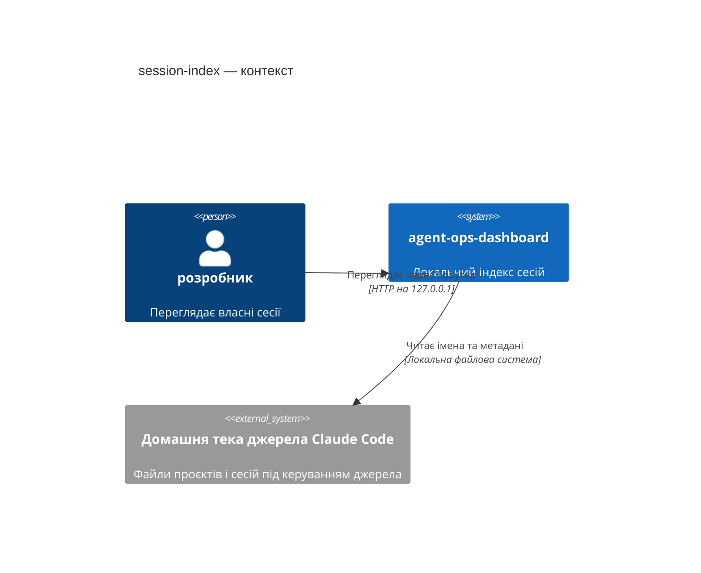
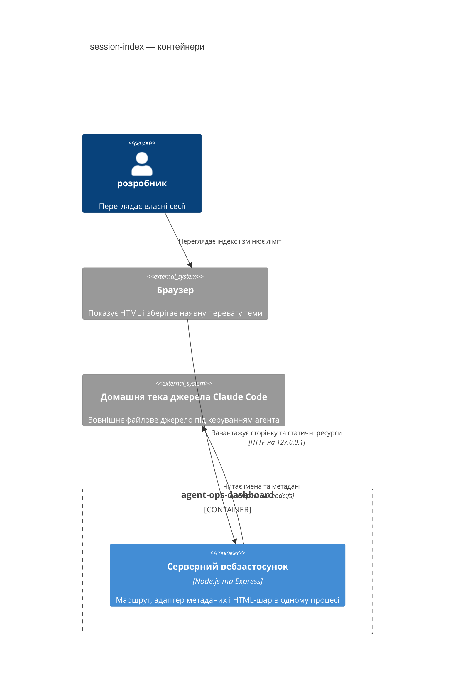
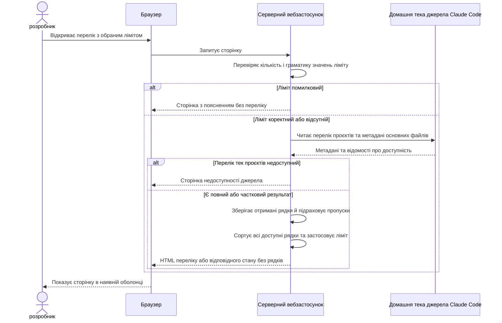

# Software Architecture Document — session-index

<!-- Design: depth medium, route standard. Owner-approved strategic decisions and diagrams; quality scenarios and risks derived from the spec and repo constraints. Clean-context critic: NO_CONTESTED_DECISIONS. Structural self-check: PASS. -->
<!-- C4 Context (L1) lives inline in §3. C4 Container (L2) lives inline in §5. -->
<!-- Numbers in §10 come VERBATIM from spec.md §6 NFR — no inventing, no rounding. -->

## 1. Introduction and goals

**Intent.** Дати розробнику спільний індекс сесій усіх проєктів одного джерела: повний ID, проєкт, байти й час зміни. Перелік будується з метаданих, упорядковується за свіжістю та явно показує неповноту результату. Обсяг визначає [spec.md](spec.md) §1–§3; решта кроку roadmap залишається поза цим зрізом.

**Top-3 quality goals:**

1. Приватність і недоторканність джерела: runtime не відкриває журнали й не пише в домашню теку агента.
2. Точність складу, метаданих і стабільного порядку: тільки основні сесії, глобальне сортування перед лімітом.
3. Чесний результат за збоїв: розрізняти порожнечу, доступну частину та недоступність джерела, зберігати вже отримані рядки.

**Stakeholders.**

| Role | Interest | Sign-off owner? |
|---|---|---|
| розробник | Перегляд власних сесій; приватність і зрозуміла повнота результату | Так; maintainer відповідає за технічне приймання SAD і security review |

**Decision overrides.** Немає.

## 2. Constraints

**Technical.** JavaScript ESM, Node.js >=22, рекомендовано Node 24; CI перевіряє 22, 24 і 26. Express 5.2.1 у lockfile — єдина залежність. Наявний один процес із серверним HTML, синхронним `node:fs`, прямими викликами функцій і чистим HTML-шаром. Немає БД, фронтенд-збірки, нових залежностей, кешу чи фонового оновлення. Слухач залишається на `127.0.0.1`, CSP зберігається.

**Organisational.** Розмір S, маршрут standard; власник maintainer. Окремий календарний строк і бюджет не задані специфікацією й не використовуються як архітектурні обмеження. До tasks належить закрити OQ-01 про затримку й обсяг дерева; security review потрібен до приймання.

**Conventions.** [AGENTS.md](../../../AGENTS.md), `.claude/rules/javascript.md`, `.claude/rules/tests.md`, `.claude/rules/views.md`, [design-system.md](../../design-system.md). Named exports, без класів, синхронні файлові операції; дані у HTML проходять через `esc()`. Тести — `node:test`, ворота — `npm run verify`; тести й demo використовують тільки синтетичні джерела. Код і коментарі англійською, документи українською.

**Regulatory / external.** Дані confidential за spec §6.1; зовнішніх одержувачів і телеметрії немає. Окремих правових вимог специфікація не задає. [Загальний ADR-0001](../../adr/0001-read-only-agent-home-closed-field-list.md) успадковується, а цей зріз суворіший: жодного читання вмісту JSONL, навіть дозволених службових полів. Файлові права машини не обходяться.

## 3. Context and scope

Розробник відкриває індекс сесій у браузері на власній машині. Дашборд отримує метадані тільки з домашньої теки налаштованого джерела Claude Code; дочірні символічні посилання не розгортаються. Назви файлів, проєктів і шлях джерела вважаються недовіреним текстом на межі HTML.

<!-- brownfield: existing architecture-map.md reflects_commit 772bc61 is fresh for runtime; git diff 772bc61..277f4b2 changes only docs. No rescan needed. -->

**External systems (in / out):**

| Actor or system | Type | Interaction |
|---|---|---|
| розробник | Person | Відкриває індекс і задає кількість рядків через локальний браузер |
| Домашня тека джерела Claude Code | System (external) | Дашборд читає імена й метадані; життєвим циклом файлів керує джерело |

Інших зовнішніх систем немає. Явно налаштований корінь є рішенням розробника; дашборд не підставляє типову теку за помилок. Автентифікація й облікові записи не додаються.

**C4 Context (L1):**

## 4. Solution strategy

**1. Target surface — один серверний вебзастосунок (confirmed).** `target_surfaces: [web-frontend]`: один процес Express складає готову HTML-сторінку й віддає її локальному браузеру. Серверна частина є частиною цього SSR-контейнера; окремого backend-сервісу чи нового машинного інтерфейсу цей зріз не вводить. Власник підтвердив цю форму застосунку відповіддю «так».

**UI architecture (inherited).** Серверне складання HTML через наявний `layout()`, стилі й тему з дизайн-канону. Стан кількості рядків належить запиту сторінки; новий браузерний стан індексу не потрібен. Це успадковані обмеження spec §6, а не вибір між новими UI-стеками, тому окремого ADR про SSR немає.

**2. Перелік на головній, ліміт в адресі (confirmed).** `/` замінює заглушку переліком із 50 рядками; `/?limit=100` задає 100 рядків. Адреса зберігає вибір без нового браузерного стану. Власник обрав варіант 1; причини й альтернатива `/sessions` записані в [ADR-0001](adr/0001-serve-session-index-at-root-with-query-limit.md).

**3. Метадані окремо від вибору рядків (confirmed).** Адаптер синхронно повертає всі доступні метадані та відомості про пропуски. Маршрут перевіряє ліміт до обходу, глобально сортує отримані рядки й лише тоді обмежує результат. HTML-шар тільки відображає готову модель. Власник обрав варіант 1; [ADR-0002](adr/0002-return-complete-metadata-before-presentation-selection.md) фіксує альтернативу, де адаптер сам застосовує ліміт.

Кожне відкриття запускає новий обхід без кешу чи збереженого індексу. Похідний підпис проєкту не використовується для доступу до диска. Відомості про неповноту проходять до сторінки разом із рядками, а не перетворюються на успішну порожнечу.

<!-- Edits-log: [] (approvals only). ADR-spawns log: [{adr_id: "0001", title: "serve-session-index-at-root-with-query-limit", section: 4, triggered_by: "multi-module impact + legitimate alternative /sessions"}, {adr_id: "0002", title: "return-complete-metadata-before-presentation-selection", section: 4, triggered_by: "adapter/route/view contract + legitimate adapter-side selection alternative"}]. Neither decision is claimed irreversible. -->

## 5. Building block view

Зберігається наявна проста будова: маршрут викликає адаптер через реєстр джерел і передає готову модель чистій функції представлення. Читач метаданих виділяється в `lib/claude/sessions.js`, нова сторінка — у `views/sessions.js`; додаткового сервісного шару немає. Усі модулі працюють усередині одного процесу Express.

**Internal decomposition (confirmed):**

| Module | Responsibility | Boundary |
|---|---|---|
| `server.js` | Обробити `/`, перевірити ліміт, отримати джерело, викликати читач, відсортувати й обмежити рядки, вибрати відповідь | Не обходить файлове дерево; не читає JSONL |
| `lib/sources.js` | Наявний реєстр і `getSource('claude')` | `listSources()` і health-контракт залишаються сумісними |
| `lib/claude/index.js` | Зареєструвати `listSessions()` разом із наявними `id`, `label`, `home()` | Імпорт у `server.js` продовжує забезпечувати реєстрацію |
| `lib/claude/sessions.js` | Синхронний обхід потрібної глибини, метадані основних файлів, підрахунок пропусків | Не приймає ліміт, не складає HTML, не відкриває журнали |
| `views/sessions.js` | HTML переліку, підсумків, порожнього й помилкових станів із готової моделі | Не імпортує адаптер чи `node:fs`; усі значення даних проходять `esc()` |
| `views/layout.js`, `public/style.css`, `public/theme.js` | Наявна оболонка, токени, компоненти й тема | Перевикористання дизайн-канону; нові стилі лише за потреби читабельності |

**Internal data contract (confirmed).** `listSessions()` повертає plain-об'єкт, без власних класів чи сирих винятків:

| Field | Type / invariant |
|---|---|
| `state` | `complete`, `partial` або `unavailable` |
| `sessions` | Масив усіх успішно отриманих рядків; кожний містить `id` (string), `projectKey` (string — початкове ім'я теки), `projectPath` (string — похідний підпис), `sizeBytes` (number), `mtimeMs` (number) |
| `skippedProjects` | Невід'ємне ціле; кожний пропущений проєкт рахується один раз |
| `skippedFiles` | Невід'ємне ціле; лише основні кандидати сесій, чиї метадані отримати не вдалося; пропущений проєкт не додається сюди |

Ідентичність рядка — пара `(projectKey, id)`. `complete` означає відсутність відомих пропусків, включно з відсутньою або порожньою текою проєктів. `partial` означає ненульовий лічильник пропусків; уже отримані рядки зберігаються. `unavailable` означає, що перелік тек проєктів прочитати не вдалося; його порожній масив і нульові лічильники є технічними значеннями, з яких заборонено виводити кількість сесій джерела.

Маршрут формує `visibleCount` і `availableCount` із масиву для `complete` / `partial`. `totalCount` дорівнює `availableCount` лише для `complete`; для `partial` він невідомий (`null`). Для `unavailable` усі підсумки кількості невідомі (`null`) і перелік не показується. Час перетворюється на ISO 8601 UTC лише для відображення; порівнюються числові `mtimeMs`, потім `projectKey` і `id` у порядку кодових одиниць.

Це внутрішня модель у пам'яті, а не нова персистентна схема чи JSON API. Конкретні екрани й контроли належать майбутньому `screens.md`; `ux-flows.md` у цьому зрізі відсутній.

**C4 Container (L2, confirmed):**

Єдиний контейнер фічі відповідає `web-frontend` із frontmatter. Браузер і домашня тека джерела зовнішні щодо нього. Внутрішні модулі не оголошуються окремими контейнерами чи незалежними сервісами.

## 6. Runtime view

**Critical flow 1: відкрити перелік сесій.** Перевірка ліміту передує файловому обходу. За коректного введення адаптер отримує метадані, маршрут сортує всі зібрані рядки та застосовує ліміт, представлення формує сторінку. Повний обхід не є атомарним знімком дерева.

**Failure handling (from spec AC-06–AC-10).** Відсутня тека проєктів дає повний порожній результат. Будь-яка помилка читання її переліку дає `unavailable`. Помилки окремих проєктів і файлів дають `partial`; зібрані раніше рядки залишаються в результаті й проходять спільні сортування та ліміт. Пропущений проєкт рахується один раз і не рахується додатково як файл. Якщо рядків немає, `complete` показує «Сесій поки немає», а `partial` — «Доступних сесій не знайдено; перелік неповний».

**Filesystem boundary.** Кандидати — лише звичайні `.jsonl` безпосередньо у звичайних теках проєктів. Тип перевіряється без переходу за символічними посиланнями; вкладені елементи не обходяться, навмисно виключені типи не збільшують лічильники помилок. Налаштоване джерело залишається єдиним навіть за порожнечі чи помилок. Усі очікувані файлові збої перетворюються на модель результату на відповідному рівні, без сирих винятків у HTML чи логах. Відсутність кореня треба відрізняти від відмови доступу, не підміняючи будь-який збій порожнім масивом.

Це початкова послідовність design. Стадія `sequences` доповнить §6 покриттям усіх AC, зокрема однакових дат, повтореного ліміту, зникнення проєкту після отримання рядків, дочірніх посилань і екранування. Асинхронних потоків немає.

## 7. Deployment view

<!-- N/A: reuses existing deployment unit, no infra change -->

Фіча розширює наявний локальний процес Express на `127.0.0.1`. Нових процесів, реплік, фонових задач, інфраструктури чи виробничої телеметрії не додається. Агент перевіряє застосунок тільки через `npm run demo` на синтетичних фікстурах. Числових порогів масштабування й затримки не встановлено; вимірювання та рішення належать OQ-01 до tasks.

## 8. Crosscutting concepts

**Confirmed bundle: успадковані правила й явні HTML-відповіді.**

| Concept | Convention | Where defined |
|---|---|---|
| Введення ліміту | Параметр `limit` читається зі збереженням усіх повторів. Відсутність означає 50. Рівно одне значення має відповідати послідовності десяткових цифр без знака чи пробілів і бути в межах 1–1000; початкові нулі дозволені. Не використовувати мовчазне приведення довільних рядків до числа | Spec §6, ADR-0001 |
| HTML-відповіді | `200` для повного, порожнього й часткового результату; `400` для помилкового ліміту; `503` для недоступності переліку тек проєктів. Усі відповіді мають звичну оболонку. Перелік для помилкового ліміту чи `unavailable` не показується | Цей SAD, spec AC-05–AC-10 |
| Пояснення помилок | Для ліміту: «Ліміт має бути цілим числом від 1 до 1000»; для джерела: «Не вдалося прочитати джерело сесій». За пропусків окремо показуються лічильники проєктів і файлів, доступна кількість і невідома загальна | Spec AC-05, AC-08–AC-10 |
| Безпека HTML | `esc()` для всіх значень із джерела, зокрема повного ID, початкового імені теки, похідного підпису й шляху джерела. Для динамічних атрибутів використовувати подвійні лапки й екранування. Похідний підпис не є файловим шляхом для обходу | AGENTS, rules/views, spec AC-03, AC-14 |
| Файлові операції | Синхронний `node:fs`, без читання вмісту чи запису в джерело; перевірка типу через операції без переходу за дочірніми посиланнями. Відсутність кореня можна розрізнити через `lstatSync` із `throwIfNoEntry: false`, не вводячи перехоплення сирих винятків із подальшим показом | AGENTS, rules/javascript, spec §6 |
| Доступ | Без входу чи нових ролей; файлові права діють, CSP і слухач на `127.0.0.1` зберігаються | Spec §6.1, AGENTS |
| Логи й спостережуваність | Нового логування метаданих, текстів розмов, сирих винятків або stack trace немає. Повнота видима через підсумки сторінки. `/api/health` лишається перевіркою процесу й поточного джерела, не гарантує читабельності всіх проєктів | Spec AC-15, §6.1 |
| ID та відображення | ID — ім'я без `.jsonl`; унікальність у межах проєкту, UUID-перевірки немає. Розмір — байти, час — ISO 8601 UTC. Повні значення можна прочитати на вузькому екрані | Spec AC-01–AC-04, §6 |
| UI та мова | Наявні `layout()`, `empty()`, таблиця, Note, токени й перемикач теми. Повідомлення станів відтворюють українські тексти специфікації; бренд і наявні підписи оболонки зберігаються. Нова система перекладів не додається | Spec AC-06–AC-15, design-system |
| Оновлення та стан | Нове відкриття чи перезавантаження повторює обхід; без кешу, автооновлення, пагінації, черг чи подій. Перевага теми залишається в наявному browser localStorage | Spec §6, ADR-0002 |

Коди HTTP є технічним вибором design; вони не змінюють узгоджені повідомлення чи перелік даних. Це один маршрут сторінки й одна HTML-модель відповіді. Нового спільного простору кодів помилок чи JSON API немає, тому додатковий ADR для цього набору не створюється.

## 9. Architecture decisions

| # | Title | Status | Section |
|---|---|---|---|
| [0001](adr/0001-serve-session-index-at-root-with-query-limit.md) | Serve the session index at the root with a query limit | Accepted | §4 |
| [0002](adr/0002-return-complete-metadata-before-presentation-selection.md) | Return complete metadata before presentation selection | Accepted | §4 |

Файли рішень цього зрізу лежать у `docs/features/session-index/adr/`. Загальний [ADR-0001](../../adr/0001-read-only-agent-home-closed-field-list.md) успадковується як обмеження, а не дублюється у feature-ADR. Інші домовленості успадковані зі специфікації або стосуються одного маршруту й не проходять поріг окремого ADR.

## 10. Quality requirements

Цілі та числові пороги нижче перенесені зі spec §6 без зміни. Це план перевірок майбутньої реалізації; поточний design не означає, що індекс уже реалізований чи пройшов ці перевірки.

**QG-1. Приватність і недоторканність джерела.**

- **When:** індекс обробляє синтетичне дерево з довільним або нечитабельним вмістом основних файлів, окремо з явно налаштованою іншою домашньою текою.
- **Then:** «0 відкриттів вмісту журналів у runtime індексу»; «0 операцій запису з runtime індексу в домашню теку джерела»; «0 звернень до особистої домашньої теки агента з тестів та demo» (spec §6, рядки Приватність читання / Недоторканність джерела / Ізоляція перевірок).
- **How verify:** контроль синхронних файлових викликів на ізольованому синтетичному джерелі, контроль `CLAUDE_HOME` до імпорту сервера, порівняння складу, вмісту та mtime дерева до й після запиту. Тестовий код може читати синтетичний вміст для порівняння; runtime індексу — ні. Зміна вмісту зі збереженням метаданих не змінює рядків індексу. atime не є гарантією.

**QG-2. Точність складу, метаданих і порядку.**

- **When:** є сесії кількох проєктів, вкладені транскрипти, сторонні файли, дочірні посилання та однакові дати; перевіряються типовий і граничні ліміти.
- **Then:** «100% відповідності основним файлам доступних проєктів до застосування ліміту; 0 вкладених транскриптів»; «100% збігу байтів і часу зміни; 0 перестановок за незмінного дерева, включно з однаковими датами» (spec §6, рядки Точність складу / Точність метаданих і порядку).
- **How verify:** незалежний `test/oracle.js` із `exactDepth: 2`, контрольні дерева з відомими метаданими, повторні запити й порівняння глобально відсортованого префікса. Окремі синтетичні дерева перевищують типовий і максимальний ліміти. Порівняння `projectKey` та ID перевіряється зі змішаним регістром, без `localeCompare`. Перед тестами `npm run verify` вирівнює mtime базових фікстур через preverify.

**QG-3. Чесний результат за збоїв.**

- **When:** тека проєктів відсутня або порожня, її перелік недоступний, не читається один чи всі проєкти, зникає файл або проєкт після отримання частини рядків.
- **Then:** стани, лічильники й тексти відповідають spec AC-06–AC-10. `partial` зберігає доступні рядки й невідому загальну кількість, навіть коли рядків немає; `unavailable` не стає успішним порожнім результатом. Відсутній корінь означає порожнечу. Числового SLO для цих збоїв специфікація не вводить.
- **How verify:** керовані збої синхронних файлових операцій на відповідних рівнях, включно з помилкою після успішного отримання рядків, та HTTP-перевірки відповідного HTML, кодів і лічильників. Відмови доступу моделюються незалежно від реальних прав ОС, щоб тести працювали на Windows і під привілейованим обліковим записом. Oracle не є еталоном цих помилкових станів.

**QG-4. Сумісність і читабельність оболонки (supporting).**

- **When:** нову сторінку відкривають у наявній оболонці зі спеціальними символами в даних і довгими повними значеннями.
- **Then:** «3 з 3 наявних тестів оболонки проходять, 0 послаблень CSP і прив'язки до локальної адреси»; «4 поля рядка доступні за ширини 320 і 1280 CSS px у 2 темах; 0 обрізаних значень без способу їх прочитати» (spec §6, рядки Регресійна сумісність / Читабельність). Значення відображаються як текст за AC-14.
- **How verify:** `npm run verify`, перевірка точних директив CSP та локального слухача, HTTP-перевірки екранування, поточного джерела й health, огляд demo в браузері на обох ширинах у двох темах. Дозволено перенесення або прокручування всередині таблиці; лише `title` не слід вважати достатнім способом прочитати обрізані значення на вузькому екрані. Поведінка перемикача теми перевіряється в браузері окремо від трьох наявних тестів.

**Performance.** Числових цілей затримки чи порогів обсягу тут немає. До tasks треба виміряти холодні та повторні запити на синтетичних деревах, записати обсяг, середовище й p95 та закрити OQ-01 із maintainer.

## 11. Risks and technical debt

| Risk / debt | Severity | Mitigation | Owner |
|---|---|---|---|
| Open architectural decision: OQ-01 — прийнятна затримка та обсяг дерева не погоджені | Open question | Resolve before `sdd:tasks session-index`; виміряти повне сканування синтетичних дерев різного обсягу, холодні й повторні запити, версію середовища та p95; зберігається початкове відкладення spec §8, нової числової обіцянки чи кешу немає | maintainer |
| Повний синхронний обхід і сортування блокують процес на великих деревах; ліміт обмежує показ, а не обхід | Medium | Вимірювання в OQ-01 до tasks. Не оголошувати ліміт захистом від вартості сканування. Зміна стратегії потребує повернення до специфікації, якщо виходить за поточний зріз | maintainer |
| Дерево змінюється під час обходу, тому результат не є атомарним знімком | Medium | Успадковане обмеження spec §6: зберігати вже отримані рядки, позначати відомі пропуски й перевіряти керовані зникнення проєктів та файлів | maintainer |
| Загальне перехоплення файлових помилок може приховати відмову доступу як порожнє джерело | High | Відокремити відсутність кореня від інших збоїв. Тести розрізняють `complete`, `partial`, `unavailable`, включно з недоступністю всіх проєктів. Без обходу файлових прав | maintainer |
| Власні рядки проєктів і шлях джерела можуть створити розмітку або розкрити приватні назви | High | `esc()` на всіх динамічних значеннях, локальний слухач, незмінна CSP, відсутність нового логування. Security review до приймання, як вимагає spec §6.1 | maintainer |
| Наявні стилі обрізають ID і шляхи, а поточна заглушка вставляє `claudeHome()` у body без `esc()` | High | За заміни заглушки передавати home через безпечний параметр `layout()` або явно екранувати. Забезпечити читання повних значень на вузькому екрані й перевірити обидві теми; не покладатися лише на старі тести оболонки | maintainer |
| Реєстрація адаптера відбувається на імпорті, тому втрата імпорту прибере джерело з реєстру | Medium | Зберегти імпорт адаптера у `server.js`, перевірити `getSource('claude')`, health і позначення джерела на сторінці | maintainer |

**Accepted debt (успадковано зі spec, без нових послаблень).** Цілісного знімка дерева не гарантуємо; кеш і числова обіцянка затримки відсутні. Похідний підпис проєкту не є достовірним робочим шляхом, тому початкове ім'я теки й позначка «похідний» зберігаються. Решта кроку session-index із roadmap не вважається завершеною цим зрізом.

## 12. Glossary

Канонічне джерело — [CONTEXT.md](../../../CONTEXT.md). Нових доменних термінів цей SAD не вводить.

| Term | Meaning |
|---|---|
| розробник | Людина, яка відкриває локальний дашборд, щоб переглянути власні сесії; без облікових записів і ролей |
| джерело | Coding-агент, чиї сесії читає дашборд; у цьому зрізі тільки Claude Code |
| проєкт | Тека проєкту в домашній теці джерела; ім'я кодує шлях, який однозначно не відновлюється |
| сесія | Основний файл `<sessionId>.jsonl` безпосередньо в теці проєкту; вкладені транскрипти й результати інструментів не є окремими сесіями |
| індекс сесій | Перелік сесій усіх проєктів, побудований із метаданих файлів |

**Design validation (2026-11-10).** Незалежний clean-context критик: `NO_CONTESTED_DECISIONS`. Структурна самоперевірка пройшла: усі секції Arc42 заповнені, Mermaid-блоки перевірені структурно, feature-ADR мають статус Accepted і замкнений індекс у §9, локальні посилання ведуть до наявних файлів, цілі NFR у §10 збігаються зі spec, OQ-01 має власника й строк. Рендерер Mermaid недоступний; візуальний рендер схем не виконувався.

`npm run verify`: початковий запуск у sandbox завершився `TypeError` у `startServer()` через `server.address() === null`; повторний запуск поза sandbox пройшов, 3 тести успішні, 0 невдалих. Це наявні тести оболонки, а не докази реалізації майбутнього індексу. Demo та перевірки майбутніх сценаріїв із §10 на стадії design не запускалися. Наступний крок — `sequences`; OQ-01 залишається до tasks, а security review — до приймання реалізації.

