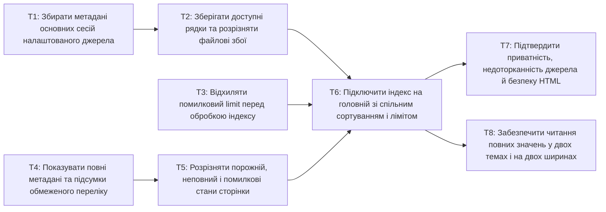

# Epic — session-index

> **Spec:** [spec.md](../spec.md) · **Design:** [sad.md](../sad.md) · **ADRs:** [adr/](../adr/) · **Машинний контракт:** [tasks.json](../tasks.json).

## Goal

Дати єдиний перелік основних сесій усіх проєктів налаштованого джерела: повний ID, проєкт, байти й UTC-дата. Глобальне сортування перед лімітом допомагає знайти недавні сесії; явні стани повноти не видають файлові збої за порожнечу.

— `spec.md §2, Goals, abridged` · [повний текст](../spec.md).

## Scope

- **In:** читач `lib/claude/sessions.js`, реєстрація адаптера, `GET /?limit=…`, чистий `views/sessions.js`, локальні CSS-правки читабельності, тести та докази перевірок.
- **Out:** читання JSONL, аналітика/графіки, назви й пошук, сторінки проєкту/сесії, інше джерело, БД, міграції, кеш, новий JSON API, залежності та зміна теми.

— `spec.md §1–§3, вузький зріз, abridged` · [повний текст](../spec.md); `sad.md §5, Internal decomposition, abridged` · [повний текст](../sad.md).

Розмір **S**, маршрут **standard**, поверхня **web-frontend** з `.size`, `.route` і frontmatter SAD. Вісім коротких задач по 3–5 годин, кожна зі своїми тестами; це деталізація вузького зрізу, а не зміна розміру. Міграцій, data-model, OpenAPI, screens.md і ux-flows.md немає; відсутні документи не підмінено вигаданими схемами чи SCR-id. Для HTML-контракту використано SAD §4/§8; UI-задачі перевикористовують канон.

**OQ-01 — відкритий контроль до приймання.** Рішенням maintainer від 2026-11-11 строк перенесено після T6, до приймання; старт задач дозволений без попередніх вимірювань. На реалізованому індексі виміряти перші й повторні HTTP-запити до синтетичних дерев різного обсягу, зафіксувати кількість проєктів/сесій, середовище та p95. До приймання maintainer погоджує прийнятну затримку й обсяг. Числової гарантії до вимірювань і кешу немає; це явна зміна строку, а не закриття питання.

> - [ ] **OQ-01 — Яку затримку відкриття індексу вважаємо прийнятною та для якого обсягу дерева?** Рішення maintainer від 2026-11-11: після T6 виміряти перші й повторні HTTP-запити до реалізованого індексу на синтетичних деревах різного обсягу; зафіксувати кількість проєктів/сесій, середовище та p95. До приймання maintainer погоджує прийнятну затримку й обсяг. До вимірювань числової гарантії немає; кеш не вводиться, вміст JSONL не читається. OQ-01 не блокує старт задач. — owner: maintainer, due: after T6, before feature acceptance.

— `spec.md §8, OQ-01, verbatim` · [повний текст](../spec.md)

> | Open architectural decision: OQ-01 — прийнятна затримка та обсяг дерева не погоджені | Open question | Після T6, до приймання: виміряти перші й повторні HTTP-запити до реалізованого індексу на синтетичних деревах, зафіксувати кількість проєктів/сесій, середовище й p95; maintainer погоджує затримку й обсяг. Рішення maintainer від 2026-11-11, spec §8; старт задач дозволений, числової гарантії й кешу немає | maintainer |

— `sad.md §11, OQ-01, verbatim` · [повний текст](../sad.md)

## Task map

За залежностями незалежно стартують T1, T3 і T4; OQ-01 їхній старт не блокує. Далі T2 та T5; після їх завершення — T6; T7 і T8 знову незалежні. Спільні файли читача, server.js і views/sessions.js утворюють послідовні смуги; статично типізованих compile-coupled контрактів немає. DAG показує можливий паралелізм, але поточні налаштування виконання `max_parallel_agents: 1` лишають його послідовним.

## Tasks

Стани: [tracker.md](tracker.md). Машинна модель: [tasks.json](../tasks.json).

| # | Task | Layer | Blocked by | DoD (short) |
|---|---|---|---|---|
| T1 | [Збирати метадані основних сесій налаштованого джерела](read-session-metadata.md) | infra | — | Тести test/session-metadata.test.js підтверджують точний склад, метадані, порожнечу, ізоляцію та виключення посилань; npm run verify проходить. |
| T2 | [Зберігати доступні рядки та розрізняти файлові збої](preserve-partial-results.md) | infra | T1 | Тести test/session-read-errors.test.js перевіряють AC-08–AC-10 для всіх рівнів збоїв, збереження рядків та лічильники; npm run verify проходить. |
| T3 | [Відхиляти помилковий limit перед обробкою індексу](validate-query-limit.md) | ports | — | HTTP-тести test/session-limit.test.js перевіряють точну граматику, дублікати та відповідь 400 без переліку; npm run verify проходить. |
| T4 | [Показувати повні метадані та підсумки обмеженого переліку](render-session-table.md) | ui | — | Тести test/session-view.test.js підтверджують поля, UTC, похідний підпис, підсумки, безпечний HTML і керування limit; npm run verify проходить. |
| T5 | [Розрізняти порожній, неповний і помилкові стани сторінки](render-session-states.md) | ui | T4 | Тести test/session-view-states.test.js перевіряють усі стани, точні повідомлення й підсумки AC-05–AC-10; npm run verify проходить. |
| T6 | [Підключити індекс на головній зі спільним сортуванням і лімітом](wire-session-index.md) | wiring | T2, T3, T5 | HTTP-тести test/session-index.test.js підтверджують сортування перед лімітом, 1/50/1000, 200/400/503, ранню валідацію, ізоляцію та незмінний health; npm run verify проходить. |
| T7 | [Підтвердити приватність, недоторканність джерела й безпеку HTML](verify-index-privacy.md) | tests | T6 | Тести test/session-security.test.js підтверджують 0 відкриттів JSONL, 0 записів, ізоляцію, escaping і незмінну CSP; security-check.md містить фактичні результати, npm run verify проходить. |
| T8 | [Забезпечити читання повних значень у двох темах і на двох ширинах](verify-responsive-shell.md) | ui | T6 | Тести test/session-readable.test.js і npm run verify проходять; ui-check.md фіксує браузерну перевірку 320/1280 px у двох темах, повних значень і збереження теми. |

## Risks / Hard rules

**Coverage:** AC-01 → T1/T4/T6/T8; AC-02 → T1/T7; AC-03 → T1/T4/T8; AC-04 → T3/T4/T6; AC-05 → T3/T5/T6; AC-06–AC-07 → T1/T5; AC-08–AC-10 → T2/T5/T6; AC-11 → T1/T6/T7; AC-12–AC-13 → T1/T7; AC-14 → T4/T7/T8; AC-15 → T6/T7/T8. Повний критерій може вимагати кількох задач; частковий внесок названо в тілі кожної.

**Validation (2026-11-10):** structural self-check: **12/12 PASS** — JSON-контракт, наявні task pointers, ациклічний DAG і паралельні гілки, дзеркало frontmatter/JSON, точний inverse `blocks`, дев’ять секцій шаблону, оцінки до одного дня, виміряні бюджети контексту, покриття 15/15 AC, дослівні AC та 147 витягів із provenance, наявні локальні посилання й узгоджений tracker. Усі бюджети M: 50–90 непорожніх рядків. Mermaid перевірено структурним lint, граф збігається з JSON; `mmdc` і локальний Mermaid відсутні, render/parse не виконувався.

`npm run verify`: запуск у sandbox завершився `TypeError` у `startServer()` через `server.address() === null`; повторний запуск поза sandbox — **3 тести успішні, 0 невдалих**. Це наявні тести оболонки; тести майбутнього індексу ще не написані. Demo, браузерні перевірки й вимірювання OQ-01 на цій стадії не виконувалися. Структурна перевірка декомпозиції не закриває OQ-01 і не є прийманням реалізації. Актуальний строк OQ-01 після рішення maintainer від 2026-11-11 — після T6, до приймання.

> - Вміст JSONL не читається взагалі, навіть дозволені ADR-0001 службові поля. Можна читати імена, розмір і mtime. Виняток підготовки синтетичних фікстур у `scripts/pin-fixture-mtimes.mjs` не є runtime індексу.

— `spec.md §6, приватність читання, verbatim` · [повний текст](../spec.md)

> - Використовуються наявні серверне складання HTML, стилі, тема й тестовий рушій; без нових залежностей, фронтенд-збірки чи сховища. `npm start` агент не запускає; для огляду — лише demo.

— `spec.md §6, обмеження стеку, verbatim` · [повний текст](../spec.md)

> | Загальне перехоплення файлових помилок може приховати відмову доступу як порожнє джерело | High | Відокремити відсутність кореня від інших збоїв. Тести розрізняють `complete`, `partial`, `unavailable`, включно з недоступністю всіх проєктів. Без обходу файлових прав | maintainer |

— `sad.md §11, помилки джерела, verbatim` · [повний текст](../sad.md)

> | Наявні стилі обрізають ID і шляхи, а поточна заглушка вставляє `claudeHome()` у body без `esc()` | High | За заміни заглушки передавати home через безпечний параметр `layout()` або явно екранувати. Забезпечити читання повних значень на вузькому екрані й перевірити обидві теми; не покладатися лише на старі тести оболонки | maintainer |

— `sad.md §11, читабельність і шлях джерела, verbatim` · [повний текст](../sad.md)

> | Власні рядки проєктів і шлях джерела можуть створити розмітку або розкрити приватні назви | High | `esc()` на всіх динамічних значеннях, локальний слухач, незмінна CSP, відсутність нового логування. Security review до приймання, як вимагає spec §6.1 | maintainer |

— `sad.md §11, security review, verbatim` · [повний текст](../sad.md)

Дизайн-канон зазвичай пропонує fallback для невалідного параметра й англійські повідомлення; тут спеціальні spec AC-05 та SAD §8 мають пріоритет: HTTP 400, без переліку й точні українські тексти. Ліміт обмежує показ, а не вартість обходу. Нових runtime-логів немає.

— `spec.md §5, AC-05, abridged` · [повний текст](../spec.md); `sad.md §8, Введення ліміту / UI та мова / Логи й спостережуваність, abridged` · [повний текст](../sad.md).
